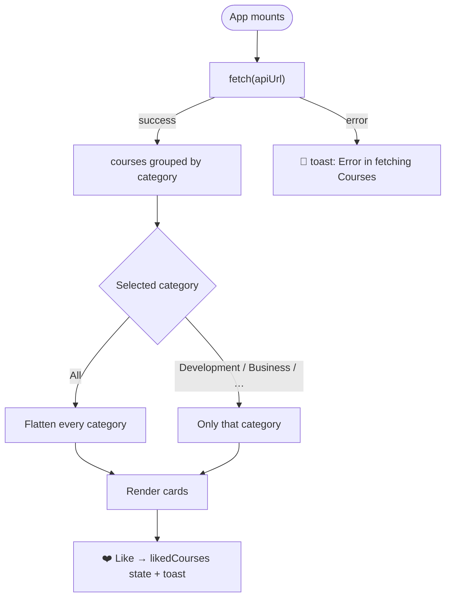

<div align="center">

# 📚 Courses Catalog

**Browse top courses by category, like your favourites and get instant feedback — a React app that fetches live course data from an API.**

[](https://courses-catalog.vercel.app)


[Features](#-features) · [How it works](#-how-it-works) · [Getting Started](#-getting-started) · [Structure](#-project-structure)

</div>

---

## ✨ Features

| | Feature |
|---|---|
| 🌐 | **Live data** fetched from a public courses API on load |
| 🗂️ | **Category filter** — All · Development · Business · Design · Lifestyle |
| ❤️ | **Like / unlike** any course, with a heart toggle |
| 🔔 | **Toast notifications** for likes, unlikes and fetch errors |
| ⏳ | **Loading spinner** while courses are fetched |
| 📝 | **Readable cards** — image, title and a trimmed description |

## 🔄 How it works



## 🚀 Getting Started

```bash
git clone https://github.com/Shariq2003/Courses_Catalog.git
cd Courses_Catalog
npm install
npm start            # http://localhost:3000
```

<details>
<summary><b>📜 Available scripts</b></summary>

| Command | What it does |
|---|---|
| `npm start` | Run the dev server |
| `npm run build` | Production build into `build/` |
| `npm test` | Run tests |

</details>

## 📁 Project Structure

<details>
<summary><b>Expand tree</b></summary>

```text
src/
├── components/
│   ├── Filter.jsx     # category buttons
│   ├── Cards.jsx      # filters & lists cards, owns likedCourses
│   ├── Card.jsx       # single course + like button
│   └── Spinner.js
├── data.js            # apiUrl + filter categories
└── App.js             # fetch, loading state, layout
```

</details>

---

<div align="center">

Built by **[Shariq](https://github.com/Shariq2003)** · [LinkedIn](https://www.linkedin.com/in/shariq-sd)

⭐ If you like this project, consider giving it a star!

</div>
